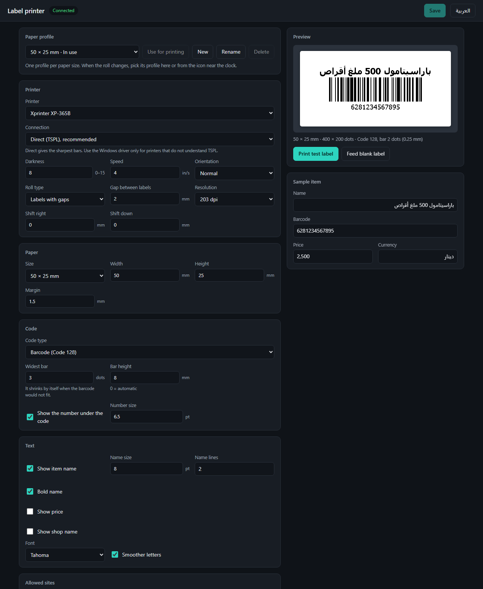

# HDD Label Agent

A small Windows tray program that lets a web page print barcode and QR labels on the label printer
attached to the same computer. The page sends the item's data to `http://127.0.0.1:17365`; the agent
draws the label, with correct Arabic, and sends it to the printer.


It was written for a pharmacy/shop management web app, but nothing in it is specific to that app: any
site the user allows can print through it.

## What it does

- **Sharp bars.** The label is drawn at the printer's own resolution and every bar is a whole number
  of printer dots wide, so nothing is stretched or blurred.
- **Arabic and mixed text.** Text goes through Windows text shaping, so Arabic letters join and run
  right to left, also when mixed with English words and numbers.
- **Code 128, EAN-13 and QR.** One setting switches between them.
- **Paper profiles.** One profile per paper size and printer; switch when the roll changes.
- **Settings page with live preview**, in English and Arabic, served by the agent itself.
- **An answer for the web page.** The page learns whether the label was sent or why it was not
  ("the printer is offline", "this barcode is too long for the label").
- **Permission per site.** The first time a site tries to print, the agent asks the person at the
  computer whether to allow it.

## Requirements

- Windows 10 or 11, 64-bit.
- A label printer installed in Windows. *Direct* mode needs a printer that understands TSPL
  (Xprinter, TSC, Gprinter and many others); *Windows driver* mode works with any printer.
- Nothing else: the downloadable program carries its own .NET.

**Tested hardware:** developed against an Xprinter XP-365B (203 dpi) with 50 × 25 mm gap labels in
direct mode. Windows driver mode is implemented but has not been tried on a real printer yet.

## Getting started

1. Download
   [HddLabelAgent.exe](https://github.com/HassanDomeDenea/HddLabelAgent/releases/latest/download/HddLabelAgent.exe)
   (about 60 MB, from the [latest release](https://github.com/HassanDomeDenea/HddLabelAgent/releases/latest))
   onto the computer the printer is attached to. There is no installer: put the file in a folder
   where it can stay, for example `C:\HddLabelAgent`.
2. Start it. An icon appears near the clock.
3. Double-click the icon. The settings page opens in the browser. Choose the printer and the paper
   size, press **Print test label**, adjust until it looks right, then **Save**.
4. Right-click the icon and tick **Start with Windows**.

Starting the program a second time does not start a second copy; it opens the settings page.

The program is not code-signed, so the first start may show "Windows protected your PC". Choose
**More info**, then **Run anyway**. Each release lists the file's SHA-256 so the download can be
checked:

```powershell
Get-FileHash .\HddLabelAgent.exe -Algorithm SHA256
```

To update, exit the agent from its tray menu, replace the file with the new one and start it again.
The settings are kept; they live in `%AppData%`, not next to the program.

## The settings page



Everything is changed here and the preview follows as you type. **Print test label** prints with the
settings on screen, saved or not, so a layout can be tried before it is kept. Every setting is
described in [docs/settings.md](docs/settings.md).

## Printing from a web page

```js
const response = await fetch('http://127.0.0.1:17365/api/print', {
    method: 'POST',
    headers: {'Content-Type': 'application/json'},
    body: JSON.stringify({
        items: [{
            barcode: '6281234567895',
            name: 'Paracetamol 500 mg tablets',
            price: '2,500',
            priceWithCurrency: '2,500 IQD',
            copies: 2,
        }],
    }),
});
const result = await response.json();
if (!response.ok) alert(result.error);
```

The page sends data only. How the label looks (which lines are shown, sizes, code type, paper) is
decided by the agent's settings on that computer, so two computers with different printers and paper
can print from the same page.

- [docs/integration.md](docs/integration.md): a complete client, finding out whether the agent is
  running, the permission question, and falling back when it is not there.
- [docs/api.md](docs/api.md): every endpoint.

## How it works

1. The label is drawn into a bitmap that has exactly one pixel per printer dot (400 × 200 for
   50 × 25 mm at 203 dpi). Text is drawn by GDI+; the bar pattern comes from
   [ZXing.Net](https://github.com/micjahn/ZXing.Net) and is painted a whole number of dots per bar.
2. The bitmap is reduced to pure black and white.
3. In direct mode it is sent as a TSPL `BITMAP` command through the Windows spooler without the
   driver touching it. In Windows driver mode the same bitmap is printed as an ordinary page.

Because the printer receives a finished picture, its built-in fonts are never used, which is what
makes Arabic work on printers that have no Arabic font.

## Security

The agent accepts requests that make a printer print, so it is careful about who may send them.

- It listens on the loopback address only. Another computer cannot reach it.
- A site that has not been allowed is refused. The first request from a new site opens a question
  on the computer's screen; "yes" is remembered, "no" lasts until the agent is restarted. Allowed
  sites are listed, and can be removed, on the settings page.
- Requests whose `Host` is not the loopback address are refused (DNS rebinding).
- Requests that change something must be JSON, so a plain HTML form on some web page cannot send one.
- `GET /api/ping` is the only thing an unknown site can read. It says that the agent is there and
  its version, nothing else.

Programs running on the computer itself (not in a browser) are not asked for permission; they could
use the printer directly anyway.

## Where it keeps things

| File | What |
| --- | --- |
| `%AppData%\HddLabelAgent\settings.json` | All settings. Safe to edit by hand while the agent is stopped. |
| `%AppData%\HddLabelAgent\agent.log` | What was printed and what went wrong. Starts over after 1 MB. |

## When something is off

| What you see | What to do |
| --- | --- |
| "The printer … is offline" | Check its power and cable. Windows marks a USB printer offline when it is unplugged. |
| The print is upside down | Settings → Orientation. |
| The print is too light or too dark | Settings → Darkness. |
| The print sits too far left, right, up or down | Settings → Shift right / Shift down. |
| The print slides from label to label, or blank labels come out | Check Width, Height and Gap between labels, then run the printer's own paper calibration (see its manual). |
| The label comes out as white on black | Set `"invertBitmap": true` for that profile in `settings.json`. |
| Warning "the bars had to be made 1 dot wide" | The barcode is too long for the paper. Use a QR code, a shorter barcode or wider paper. |
| The web page says the agent is not running | Look for the icon near the clock. If the agent reports at start that its port is in use, change `"port"` in `settings.json` (and the address the web page uses) and start it again. |
| A site was refused by mistake | Add its address under Allowed sites on the settings page, or restart the agent and answer the question again. |

## Building and changing it

Building needs the [.NET 10 SDK](https://dotnet.microsoft.com/download).

```powershell
dotnet build HddLabelAgent\HddLabelAgent.csproj
dotnet run --project HddLabelAgent
```

`.\publish.ps1` makes the same single file the releases carry, in `publish\`. Pass `-Output` to put
it somewhere else, for instance while an agent started from `publish\` is still running.

The settings page is one file, `HddLabelAgent\wwwroot\index.html`, embedded in the program. To edit it
without rebuilding, point the environment variable `HDDLABELAGENT_WWWROOT` at that folder before
starting the agent; the page is then read from disk on every request.

| File | What is in it |
| --- | --- |
| `Program.cs` | Start-up, single instance, the tray icon and its menu. |
| `ApiServer.cs` | The HTTP endpoints and the rules about who may call them. |
| `OriginGate.cs` | The "allow this site?" question and its memory. |
| `LabelRenderer.cs` | Drawing a label: layout, text fitting, bars and QR. |
| `PrintService.cs` | Building the TSPL job, Windows driver printing, one job at a time. |
| `Spooler.cs` | Windows spooler calls: listing printers, their state, sending raw bytes. |
| `SettingsStore.cs` | Loading, checking and saving `settings.json`; the log. |
| `Models.cs` | The settings and label data. |
| `wwwroot/index.html` | The settings page. |

## License

[MIT](LICENSE). The software it includes from other authors is listed in
[THIRD-PARTY-NOTICES.md](THIRD-PARTY-NOTICES.md).
